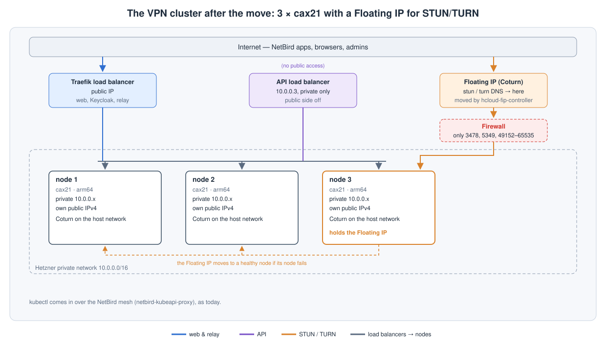

# Making a KubeAid VPN cluster highly available with zero downtime (1 → 3 control-plane nodes)

> **Cost:** use ARM nodes (Hetzner's `cax` line); cost-wise they're very cheap. Three cax21 (4 vCPU, 8 GB each) cost
> less than the single cpx32 did. The 3-node setup also uses one Floating IP and one load balancer, about €10 a month
> together (Hetzner prices, October 2026). Check first that every image the cluster runs has an arm64 build; most
> already have one, so images weren't an issue.

This is how we moved a KubeAid VPN cluster (NetBird and Keycloak) from one control-plane node to three on Hetzner
Cloud, with Cluster API. In our case, one cpx32 (amd64) became three cax21 (arm64).



## Running it as a 3-node cluster

Everything except STUN/TURN works over the private network:

- **Web and relay:** Traefik's load balancer reaches the nodes over the private network.
- **API and kubectl:** the private API load balancer, plus kubectl over the NetBird mesh.
- **A node failing:** Cluster API replaces it. The replacement comes up without the control-plane taint; see
  [Taints](#6-taints).

STUN/TURN is the only thing that needs a public IP. The nodes get a public network as well, and STUN/TURN moves to a
Floating IP that hcloud-fip-controller keeps on a healthy node; see [step 2](#2-get-everything-into-git) and
[Finish](#8-finish).

## 1. Back up everything

1. Check that all backups are running, especially Keycloak's and NetBird's.
2. Export the Keycloak realm from the UI as well: **Realm settings → Action → Partial export**, with groups, roles and
   clients included.
3. Trigger the database backups once more by hand, and check that both dumps reach the bucket:

   ```sh
   kubectl get cronjobs -n netbird; kubectl get cronjobs -n keycloakx
   kubectl -n netbird create job --from=cronjob/<backup-cronjob> pre-cp-move
   kubectl -n keycloakx create job --from=cronjob/<backup-cronjob> pre-cp-move
   ```

4. Back up the Sealed Secrets keys. Without them, nothing in `sealed-secrets/` can be decrypted on a rebuilt cluster.
   The file is itself a secret, so store it somewhere safe.

   ```sh
   kubectl -n sealed-secrets get secret -l sealedsecrets.bitnami.com/sealed-secrets-key -o yaml > sealed-secrets-keys.yaml
   ```

5. Take an etcd snapshot. It's written to the node's `/var/lib/etcd`.

   ```sh
   kubectl -n kube-system exec etcd-<control-plane-node> -- etcdctl \
     --endpoints=https://127.0.0.1:2379 --cacert=/etc/kubernetes/pki/etcd/ca.crt \
     --cert=/etc/kubernetes/pki/etcd/server.crt --key=/etc/kubernetes/pki/etcd/server.key \
     snapshot save /var/lib/etcd/pre-cp-move.db
   ```

   Then scp it to your machine. The node is the one being replaced, so the snapshot can't stay there:

   ```sh
   scp root@<node-ip>:/var/lib/etcd/pre-cp-move.db .
   ```

6. Back up the Cluster API objects. They're needed to repair or rebuild the control plane.

   ```sh
   kubectl -n capi-cluster get clusters.cluster.x-k8s.io,kubeadmcontrolplanes,machines,hcloudmachines,hcloudmachinetemplates,hetznerclusters -o yaml > capi-backup-$(date +%F).yaml
   ```

## 2. Get everything into git

Check every app's diff in Argo CD first: everything has to be in git before the move. Then raise these PRs:

1. Update the cluster to the latest KubeAid release.
2. Run Coturn as a DaemonSet instead of a Deployment.
3. The control-plane change in `values-capi-cluster.yaml`: the new machine type, `replicas: 3`, and the SSH keys of
   everyone who needs to reach the nodes, under `global.additionalUsers`. Nodes only get these users when they're
   created, so the keys have to be in this PR; adding them later starts another roll.

   ```yaml
   global:
     additionalUsers:
       - name: <user>
         sshPublicKey: ssh-rsa AAAA... <user>
   ```

4. Add hcloud-fip-controller for the STUN/TURN Floating IP, with a project-level Hetzner Cloud API token.

## 3. Protect what has to survive

Turn on Hetzner delete protection for the old server, the volumes behind its PVCs, and its public IP. Do it in the
Hetzner Cloud Console, or with these commands:

```sh
hcloud server enable-protection <old-server> delete rebuild
hcloud volume enable-protection <volume> delete        # each PVC's volume
hcloud primary-ip enable-protection <public-ip> delete
```

Put both Postgres clusters in maintenance mode, so the single-instance databases don't block the old node's drain:

```sh
kubectl -n netbird patch clusters.postgresql.cnpg.io netbird-pgsql --type merge -p '{"spec":{"nodeMaintenanceWindow":{"inProgress":true,"reusePVC":true}}}'
kubectl -n keycloakx patch clusters.postgresql.cnpg.io keycloak-pgsql --type merge -p '{"spec":{"nodeMaintenanceWindow":{"inProgress":true,"reusePVC":true}}}'
```

## 4. Sync everything except capi-cluster

Merge the PRs and sync all apps except `capi-cluster`. Any sync of `capi-cluster` starts the roll.

## 5. Roll the control plane

The machine template is immutable and keeps its name, so the machine type can't change in place. Pause Cluster API,
delete the template, sync `capi-cluster`, check, then unpause:

```sh
# the cluster's name in Cluster API
CLUSTER=<cluster-name>

# pause
kubectl -n capi-cluster patch clusters.cluster.x-k8s.io $CLUSTER --type merge -p '{"spec":{"paused":true}}'

# delete the template, then sync capi-cluster in Argo CD (UI, or: argocd app sync capi-cluster)
kubectl -n capi-cluster delete hcloudmachinetemplates $CLUSTER-control-plane

# check: still paused, template has the new machine type, 3 replicas.
# Check in Argo CD first: the live Cluster, HCloudMachineTemplate and KubeadmControlPlane in the capi-cluster app.
# Fall back to these commands if that isn't possible:
kubectl -n capi-cluster get clusters.cluster.x-k8s.io $CLUSTER -o jsonpath='{.spec.paused}{"\n"}'
kubectl -n capi-cluster get hcloudmachinetemplates $CLUSTER-control-plane -o jsonpath='{.spec.template.spec.type}{"\n"}'
kubectl -n capi-cluster get kubeadmcontrolplanes $CLUSTER-control-plane -o jsonpath='{.spec.replicas}{"\n"}'

# unpause and watch the new nodes join
kubectl -n capi-cluster patch clusters.cluster.x-k8s.io $CLUSTER --type merge -p '{"spec":{"paused":false}}'
kubectl -n capi-cluster get machines -w

# only if no new machine appears
clusterctl alpha rollout restart kubeadmcontrolplane/$CLUSTER-control-plane -n capi-cluster
```

## 6. Taints

Control-plane nodes usually come up with the `NoSchedule` taint. KubeAid's template now leaves it off on a VPN
cluster that only has control-plane nodes. If a node comes up tainted anyway, remove the taint as it joins, and tell
management so the template gets fixed:

```sh
kubectl taint node <node> node-role.kubernetes.io/control-plane:NoSchedule-
```

## 7. Watch the new nodes

Check that the new nodes come up with the right machine type and architecture:

```sh
kubectl get nodes -L node.kubernetes.io/instance-type,kubernetes.io/arch
kubectl -n capi-cluster get machines
```

To debug a node that doesn't come up or join, SSH into it with a key from `global.additionalUsers` and check
cloud-init's logs:

```sh
ssh <user>@<node-ip>
sudo cloud-init status --long
sudo less /var/log/cloud-init.log          # what cloud-init did
sudo less /var/log/cloud-init-output.log   # output of kubeadm and the bootstrap commands
```

## 8. Finish

Once the new nodes are healthy:

1. Point the STUN/TURN DNS records at the Floating IP.
2. Turn off Postgres maintenance mode:

   ```sh
   kubectl -n netbird patch clusters.postgresql.cnpg.io netbird-pgsql --type json -p '[{"op":"remove","path":"/spec/nodeMaintenanceWindow"}]'
   kubectl -n keycloakx patch clusters.postgresql.cnpg.io keycloak-pgsql --type json -p '[{"op":"remove","path":"/spec/nodeMaintenanceWindow"}]'
   ```

3. Remove delete protection from the old server, the volumes and the IP:

   ```sh
   hcloud server disable-protection <old-server> delete rebuild
   hcloud volume disable-protection <volume> delete
   hcloud primary-ip disable-protection <public-ip> delete
   ```

4. Drain and remove the old node. Cluster API drains it, and with the protection off it deletes the server. If it
   doesn't:

   ```sh
   kubectl drain <old-node> --ignore-daemonsets --delete-emptydir-data
   kubectl -n capi-cluster delete machine <old-machine>
   ```

5. Sync `kube-prometheus`, so the alerts are back.
